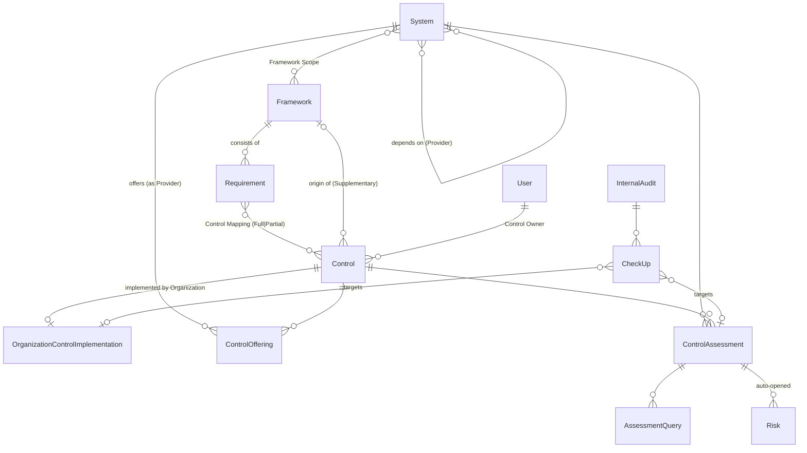

# PRD 0001: GRC requirement database

| | |
| --- | --- |
| **Status** | Accepted: the steering document for this work |
| **Date** | 2026-09-29 |
| **Owner** | aspapunktse |
| **Vocabulary** | [`CONTEXT.md`](../../CONTEXT.md) is the glossary of record. Every capitalized domain term here (Framework, Requirement, Control, Provider, …) is used exactly as defined there. |
| **Decisions** | [ADR 0005](../adr/0005-split-requirement-and-control.md) (Requirement/Control split), [ADR 0006](../adr/0006-continuous-compliance-replaces-draft-lock.md) (continuous compliance), [ADR 0007](../adr/0007-framework-scope-drives-applicability.md) (Framework Scope drives applicability), [ADR 0008](../adr/0008-providers-are-systems.md) (Providers are Systems) |

> **A note on wording.** "Requirement" is a domain term here: one line item of a Framework. To avoid confusion, this PRD calls its own product requirements **features**, numbered `F-<area>.<n>`, and never "requirements".

---

## 1. Summary

The app began as an onboarding tracker: a System is assessed against a catalog of ISO 27001 Annex A-derived items, Risks are logged, and a reviewer approves it. This PRD turns it into the first module of a **governance, risk and compliance (GRC) tool**. That module is a **requirement database** in which:

- each **Framework** (ISO 27001:2022, Cybersäkerhetslagen, CSA CCM 4, GDPR, …) is stored as its own set of **Requirements**;
- all Frameworks are mapped onto **one Control Library**, whose base is ISO 27001:2022 Annex A. Other Frameworks add **Supplementary Controls** only where no base Control covers one of their Requirements;
- a Control is implemented once and satisfies every Framework mapped to it;
- Systems are assessed per Control. Controls can be **inherited** from the Organization or from **Provider** Systems (e.g. a landing zone), in full or with shared responsibility;
- compliance is **continuous**: what applies to a System is recomputed whenever the System, its scope or the library changes, not frozen at onboarding;
- **internal audit** can send Check-ups to verify that Controls actually work, and findings flow back into assessments and Risks.

## 2. Problem

1. **One row tries to be two things.** Today a `Requirement` row is an ISO Annex A control with Framework *tags*. A tag can't say "A.8.24 fully covers CCM CEK-03 but only partly covers NIS2 Art. 21(2)(h)". It also can't list a Framework's line items that nothing covers yet. Gap analysis per Framework, the core of GRC, isn't possible.
2. **Two overlapping ways to say "this applies".** Regulatory Overlay (which drives applicability) and Framework Scope (reporting only) both express "this System is subject to X", and they can disagree.
3. **Inheritance is too coarse.** A Capability (e.g. "Active Directory") fully auto-fulfils mapped items. It isn't a System, has no assessment of its own, and can't express shared responsibility (the platform encrypts disks, the tenant manages its keys).
4. **Classification is frozen at onboarding.** After Draft, nothing that drives applicability can change, so a System that moves to the cloud or falls under a new law silently drifts out of step with reality.
5. **Organizational controls are "reference only".** Policies, screening, the management review and similar controls have no implementation status anywhere.
6. **No verification loop.** Nothing lets internal audit check whether a Control marked Fulfilled actually works.

## 3. Vision and roadmap

A single-organization GRC tool for an enterprise's systems and cloud solutions.

| Module | Content | When |
| --- | --- | --- |
| **Compliance: requirement database** | Frameworks, Requirements, Control Library, mappings, inheritance, continuous applicability, SoA, internal audit | **This PRD (v1)** |
| Compliance: evidence | Files and evidence records per Control Assessment / Check-up, evidence reuse across Frameworks | Later |
| Compliance: recurring attestation | Scheduled re-verification of Controls (e.g. yearly), recurring Internal Audits | Later |
| Risk | Risk register and treatment (partly exists today: Risks per System, Business Risk Owner portfolio) | Exists; extend later |
| Governance | Policy and document management, linked to the Organizational Controls they implement | Later |
| Platform | Real SSO (**go-live gate**, see §11), notifications (#42/#46), multi-tenancy | Later |

## 4. Goals and non-goals (v1)

**Goals**
- G1. Hold any number of Frameworks as first-class, versioned sets of Requirements, with ISO 27001:2022 as the base.
- G2. One Control Library, with a traceable **Requirement ↔ Control** mapping that states coverage and makes gaps visible.
- G3. Decide which Controls apply to a System from its Framework Scope, Deployment Facets and Impact Levels, and keep that current for the System's whole life.
- G4. Model Control Inheritance from the Organization and from Provider Systems, Full or Shared, with live status.
- G5. Produce the ISO 27001 Statement of Applicability, a coverage view per Framework, and compliance per System and portfolio.
- G6. Let internal audit verify Controls independently, and feed findings back into assessments and Risks.

**Non-goals (v1)**
- Uploading and storing evidence (links only).
- Recurring or scheduled audits and attestations.
- Email or other notifications (in-app task lists only).
- Real authentication. It remains a go-live gate (§11) and isn't part of the model work.
- Multi-tenancy.
- Governance and policy management.
- A UI for uploading Framework files (repo files plus a loader only).
- Automatic import of third-party crosswalks at runtime.

## 5. Users and roles

Existing roles are unchanged unless stated. There are two new roles and one new per-Control assignment.

| Role | New? | What it does in this module |
| --- | --- | --- |
| **Compliance Manager** | New role | Curates Frameworks, Requirements, the Control Library and Control Mappings. Publishes Frameworks. Assigns Control Owners. Authors SoA justifications. |
| **Control Owner** | New assignment (any User) | Accountable for one Control organization-wide. Maintains that Control's Organization Control Implementation. Receives Organization-level Check-ups. |
| **Internal Auditor** | New role | Reads everything. Creates Internal Audits and evaluates Check-ups. Can't edit Control Assessments, the requirement database or Risks. |
| System Owner | Existing | Declares their System's classification, Framework Scope and Provider dependencies. Assesses Controls. Answers Check-ups. For a Provider System, maintains its Control Offerings. |
| Reviewer | Existing | Onboarding Approval and Assessment Queries, as today. |
| Risk Owner | Existing | Manages Risks. Waives or marks Not Applicable mandatory Controls, as today. |
| Business Risk Owner | Existing | Scoped, read-only portfolio view. Its Framework portfolio now uses Framework Scope, which drives applicability. |
| Admin | Existing | Users, roles, and the remaining catalogs (Deployment Facet, Business Unit). Superuser, but **can't evaluate Check-ups** (independence). |
| Viewer | Existing | Read-only. |

## 6. Domain model (overview)

The full definitions are in [`CONTEXT.md`](../../CONTEXT.md). This diagram only orients.



## 7. Features

Priority uses **M** (must, v1), **S** (should, v1 if time allows) and **C** (could, later).

### F-FW: Frameworks and Requirements

| ID | Pri | Feature |
| --- | --- | --- |
| F-FW.1 | M | A Framework has a name, version, optional "supersedes" link to an earlier Framework version, `strictComplianceRequired`, a licensing flag (paraphrase-only vs quotable), and a **Draft/Published** status. |
| F-FW.2 | M | A Requirement belongs to exactly one Framework and has a code (unique within the Framework), a title, a section label for grouping, and text. For licensed Frameworks the text is an own-words paraphrase, never verbatim. |
| F-FW.3 | M | ISO 27001:2022 is flagged as the **base Framework**. It covers both Annex A (93 Requirements) and clauses 4–10. The base Framework is always in every System's Framework Scope and can't be removed from it. |
| F-FW.4 | M | Only a Compliance Manager (or Admin) can create or edit Frameworks and Requirements, and publish a Framework. A Draft Framework is invisible to Systems: it can't be put in scope and doesn't affect applicability. |
| F-FW.5 | M | Publishing a Framework triggers the applicability recompute (F-AP.3) for every System that already has it in scope. Publishing is logged as a Change Event (F-CE.1). |
| F-FW.6 | S | The Framework list shows version lineage (supersedes chain) and, for each Framework, counts of Requirements, covered Requirements and Coverage Gaps. |

### F-CL: Control Library and Control Mappings

| ID | Pri | Feature |
| --- | --- | --- |
| F-CL.1 | M | A Control keeps everything today's `Requirement` row has (code, title, description, category, mandatory, applicability Organizational/Per-System/Both, Deployment Facet scoping, CIA Impact Level thresholds, Self-Assessment Question, intent, examples) **minus** direct Framework tags and Regulatory Overlay scoping. |
| F-CL.2 | M | A Control is either a base Control (from ISO Annex A) or a **Supplementary Control** with a recorded origin Framework. |
| F-CL.3 | M | A Control has exactly one Control Owner (a User), assigned by a Compliance Manager. It may be unassigned while its Framework is still in Draft. |
| F-CL.4 | M | A Control Mapping links one Requirement to one Control, with Coverage **Full** or **Partial** and an optional rationale note. Mappings are many-to-many. |
| F-CL.5 | M | A Requirement is **covered** when its mappings together give Full coverage. Otherwise it's a **Coverage Gap**. A Compliance Manager can mark a gap **accepted**, with a justification (e.g. "not relevant to our organization"). Accepted gaps count as resolved for coverage metrics but are shown separately. |
| F-CL.6 | M | From a Coverage Gap, a Compliance Manager can create a Supplementary Control in one step, with its origin Framework preset and the mapping pre-filled. |
| F-CL.7 | M | Changing a mapping on a **Published** Framework takes effect immediately (F-AP.3). |

### F-AP: Applicability and continuous compliance

| ID | Pri | Feature |
| --- | --- | --- |
| F-AP.1 | M | A System's **applicable Controls** are the Per-System/Both Controls that are (a) mapped to at least one Requirement of a **Published** Framework in the System's Framework Scope, and (b) pass that Control's Deployment Facet and Impact Level scoping. Both conditions are combined with AND, as today. |
| F-AP.2 | M | Framework Scope, Deployment Facets, Impact Levels and Provider dependencies can be changed at **any** lifecycle stage by the System Owner or an Admin. The Draft-only lock is removed (ADR 0006). Changing Framework Scope is logged as a Change Event, as today. |
| F-AP.3 | M | **Recompute** runs on every trigger: a change to classification, Framework Scope or Provider dependencies; a Framework being published; a mapping change on a Published Framework; a Control's scoping being edited. It uses the existing diff: newly applicable → Not Started; no longer applicable and untouched → removed; no longer applicable and touched → kept as **stale**. |
| F-AP.4 | M | A recompute on an Approved or Onboarded System **never** changes its onboarding status and never reopens Approval. New Not Started mandatory Assessments show up in the System Owner's "My tasks" and in compliance figures. |
| F-AP.5 | M | The submission check (Draft → In Review) still requires every applicable mandatory Control to have an Assessment. |
| F-AP.6 | M | Regulatory Overlay is retired (UI, API and scoping). See migration §9. |

### F-AS: Assessment and derived status

| ID | Pri | Feature |
| --- | --- | --- |
| F-AS.1 | M | Systems are assessed per **Control** (Control Assessment, renamed from Requirement Assessment). Statuses, the Self-Assessment Question flow (Yes → Fulfilled, No → open + auto-Risk, N/A → gated), and the waiver/N/A restriction to Risk Owner/Admin are unchanged. |
| F-AS.2 | M | Assessment Query (renamed from Requirement Query) keeps its behaviour, now on a Control Assessment. |
| F-AS.3 | M | **Derived Requirement status** per System: **Met** (covered, and every mapped Control applicable to the System is effectively Fulfilled, see F-IN.5), **Partially Met** (some are), **Not Met** (none are). Waived/Not Applicable count as Fulfilled unless the Framework is `strictComplianceRequired`. See also OQ-1. |
| F-AS.4 | M | **Compliance Percentage** for a scope (System, Business Unit, Framework, or combination) = Met Requirements ÷ applicable Requirements, pooled across the Systems in the scope (not averaged), per Framework. This replaces the current count based on assessments. |

### F-IN: Inheritance

| ID | Pri | Feature |
| --- | --- | --- |
| F-IN.1 | M | **Organization Control Implementation**: for each Organizational/Both Control, the Organization records a status (same status set as a Control Assessment) and a description. Only the Control Owner, a Compliance Manager or an Admin can edit it. |
| F-IN.2 | M | A System can be marked as a **Provider**. For each Control, a Provider can publish a **Control Offering**: **Full** or **Shared**, with a customer-responsibility text required for Shared. The Provider's System Owner maintains the Offerings. |
| F-IN.3 | M | A System declares the Providers it **depends on** and inherits every Offering of theirs that matches one of its applicable Controls. Declaring or removing a dependency is logged as a Change Event and triggers the recompute. |
| F-IN.4 | M | Offerings count only while the Provider is **Onboarded**. Before that they're shown as "pending: Provider not Onboarded" and give no credit. |
| F-IN.5 | M | **Effective status** of a Control for a System is resolved **live** (never copied) in this order: (1) the System's own manual Control Assessment, if a human has set one, overrides everything; (2) otherwise a Full inheritance source whose status is Fulfilled; (3) a Shared source requires both the source to be Fulfilled **and** the System's own Assessment of the customer responsibility to be Fulfilled; (4) otherwise the System's own Assessment status. Every source is shown. See OQ-2 for multiple sources. |
| F-IN.6 | M | Organizational Controls that also apply per System (applicability Both) are inherited from the Organization Control Implementation by every System they apply to, in the same way as a Full Provider offering. |
| F-IN.7 | M | A change to a source's status (Provider Assessment, Organization implementation) is immediately reflected in every inheriting System's effective status and compliance figures, and logged as a `"system"` Change Event on each affected System. |
| F-IN.8 | M | Capability is retired and migrated to Provider Systems (§9). |

### F-OUT: Views and outputs

| ID | Pri | Feature |
| --- | --- | --- |
| F-OUT.1 | M | **Framework Coverage view** (Compliance Manager and above; read-only for others): each Requirement of a Framework, grouped by section, with its mapped Controls, Coverage, and Coverage Gaps / accepted gaps highlighted. Filterable to "gaps only". |
| F-OUT.2 | M | **System Control view**, on the System detail page: every applicable Control with effective status and source (*System-specific*, *Inherited from Organization*, *Inherited from Provider X: Full/Shared*), plus a **per-Framework** tab listing that Framework's Requirements with derived status and the Controls behind each. This answers "which Cybersäkerhetslagen Requirements do we meet, and how?". |
| F-OUT.3 | M | **Compliance per System and portfolio**: F-AS.4 shown per Framework on the System page, the Business Risk Owner dashboard, and the portfolio view. |
| F-OUT.4 | M | **Statement of Applicability (ISO 27001)**, org-wide. For every Control in the library: included/excluded; inclusion justification (generated from the Requirements it maps to, e.g. "ISO A.8.24; Cybersäkerhetslagen §…"); exclusion justification (authored by a Compliance Manager, required to exclude); implementation status (the Organization Control Implementation for Organizational Controls, otherwise a rollup across the Systems it applies to). A Control is *included* if it applies to the Organization or to at least one System. |
| F-OUT.5 | S | CSV export of the Framework Coverage view and the SoA. |
| F-OUT.6 | C | PDF export of the SoA. |

### F-IA: Internal audit

| ID | Pri | Feature |
| --- | --- | --- |
| F-IA.1 | M | An Internal Auditor creates an **Internal Audit**: title, scope description, one or more target Controls, a selection of Systems (by filter: Framework Scope, Deployment Facet, Business Unit, onboarding status; or picked by hand), whether to include the Organization Control Implementations, and a due date. |
| F-IA.2 | M | Launching an Internal Audit generates one **Check-up** per recipient per Control: System-level Check-ups go to the System Owner, Organization-level ones to the Control Owner. |
| F-IA.3 | M | A Check-up's question defaults to the Control's Self-Assessment Question. The auditor can edit it and add further questions before launch. |
| F-IA.4 | M | The recipient answers each question Yes/No/N/A, with a free-text description and zero or more **evidence links** (URLs). Submitting a response doesn't change any status. |
| F-IA.5 | M | Open Check-ups appear in the recipient's "My tasks" on `/home`, marked overdue after the due date. The Internal Auditor sees per-audit progress (sent, answered, evaluated, overdue). |
| F-IA.6 | M | The Internal Auditor evaluates each answered Check-up as **Conforming**, **Observation** or **Nonconformity**, with a comment. Only an Internal Auditor can evaluate; Admin and Compliance Manager can't. |
| F-IA.7 | M | A **Nonconformity** automatically (a) opens a Risk linked to the Check-up and (b) sets the targeted Control Assessment, or Organization Control Implementation, from Fulfilled back to In Progress with actor `"system"` and a note linking to the finding. Through live inheritance (F-IN.7) an Organization-level Nonconformity reaches every inheriting System. |
| F-IA.8 | M | Internal Audit and Check-up records are read-only once the audit is closed. Closing requires every Check-up to be evaluated or explicitly withdrawn. |
| F-IA.9 | M | The Internal Auditor role: read access to every System, Framework, Control, Assessment and Risk. No write access outside Internal Audits and Check-ups. |

### F-CE: Change history

| ID | Pri | Feature |
| --- | --- | --- |
| F-CE.1 | M | Extend Change Event with **System-less** events for the evidence-bearing parts of the requirement database: Control Mapping added/removed/Coverage changed; Framework published; SoA justification changed; Check-up evaluated. Other catalog edits (e.g. a Control's text) stay unlogged. |
| F-CE.2 | M | All new System-scoped mutations (Provider dependency, inherited status changes, Nonconformity side effects) are logged like today's, with the `"system"` actor for computed side effects. |

### F-IMP: Framework content and import

| ID | Pri | Feature |
| --- | --- | --- |
| F-IMP.1 | M | Import format: one file per Framework version under `prisma/seed-data/frameworks/`, containing Framework metadata, Requirements, Control Mappings (Requirement code → Control code + Coverage + rationale), and any Supplementary Controls it introduces. Sketch below. |
| F-IMP.2 | M | An idempotent loader keyed on Framework name+version and Requirement code creates or updates the Framework **as Draft**. Publishing happens in the UI after review. Re-running the loader never touches a Published Framework without an explicit flag. |
| F-IMP.3 | M | v1 content: **ISO 27001:2022** (Annex A + clauses 4–10, base), **Cybersäkerhetslagen** with its föreskrifter, and **CSA CCM 4**. Licensed texts are paraphrased. |
| F-IMP.4 | C | UI upload of Framework files. Other Frameworks (GDPR, DORA, CIS v8, NIST CSF 2.0, CMMC, MSBFS 2020:7) as data only, when needed. |

Import file sketch (illustrative, not a final schema):

```jsonc
{
  "framework": {
    "name": "CSA CCM", "version": "4.0", "supersedes": null,
    "licensing": "paraphrase-only", "strictComplianceRequired": false
  },
  "supplementaryControls": [
    { "code": "SUP-CCM-01", "title": "…", "description": "…", "applicability": "PER_SYSTEM",
      "deploymentFacets": ["Cloud IaaS/PaaS"], "question": "…" }
  ],
  "requirements": [
    { "code": "CEK-03", "section": "Cryptography, Encryption & Key Management",
      "title": "Data Encryption", "text": "<own-words paraphrase>",
      "mappings": [ { "control": "A.8.24", "coverage": "FULL", "rationale": "…" } ] }
  ]
}
```

## 8. Non-functional requirements

- **Licensing**: never store verbatim text from licensed standards (ISO, CSA and others). Only identifiers, titles and paraphrases. Public-domain law may be quoted.
- **Live, consistent derivation**: effective status, Requirement status and Compliance Percentage are computed from source data, never cached in a way that can go stale. A recompute runs in one transaction per System.
- **Scale target**: at least 500 Systems × about 400 Controls × 5 Published Frameworks, with the System page and dashboards staying interactive (target < 1 s server time). Publishing a Framework or editing a mapping that reaches every System may run as a background job, provided the UI shows it's pending.
- **Traceability**: every derived status can be explained in the UI (Requirement → mapped Controls → effective status → source).
- **Independence**: role checks for the Internal Auditor and Compliance Manager are enforced server-side, like every existing role.
- **Vocabulary**: code, UI, tests, issues and commits use the `CONTEXT.md` terms. The rename (`Requirement` → `Control` and so on) is completed in milestone 1, not left half-done.

## 9. Migration of existing data

Done in milestone order, each step reversible up to its own milestone release:

1. **Controls**: the 93 `Requirement` rows become Controls, with codes unchanged. Rename the dependent entities: Requirement Assessment → Control Assessment, Requirement Query → Assessment Query.
2. **ISO Framework**: ISO 27001:2022 gets 93 Annex A Requirements, each mapped **Full** 1:1 to the Control with the same code. Clauses 4–10 are added as Requirements mapped to new Supplementary Controls with origin ISO 27001 (e.g. "management review", "internal audit programme"). Published immediately.
3. **Other Framework tags** on existing rows (e.g. CMMC) are dropped. Those Frameworks are re-authored through the import format. Their Framework rows become Draft Frameworks. Existing Framework Scope assignments to them are kept but have no effect until the Framework is published (the only exception to F-FW.4's "Draft can't be put in scope" rule).
4. **Regulatory Overlays** → Frameworks of the same name. For each Control that was overlay-scoped, a placeholder Requirement is generated and mapped Full, flagged "migrated — curate". Every System that declared the overlay gets that Framework in scope. Unlike step 3, these are migrated as **Published**: they drive applicability today, and migrating them as Draft would silently remove Controls from Systems. They're curated in place afterwards.
5. **Capabilities** → Provider Systems created as **Onboarded**, owned by an Admin. Each mapped Control becomes a Full Offering backed by a Fulfilled Assessment noted "migrated from Capability — verify". Systems that declared the Capability now depend on the Provider. Existing auto-fulfilled Assessments turn into live inheritance with no change in effective status on migration day.
6. **Assessments, Queries, Risks, Change Events** carry over 1:1.
7. **ORGANIZATIONAL Controls** get an empty Organization Control Implementation (Not Started) and no Control Owner, which a Compliance Manager assigns afterwards.

Acceptance: for every existing System, Compliance Percentage for ISO 27001 before and after migration is explained by the new counting rule (§F-AS.4). No System loses a Fulfilled status because of the migration itself.

## 10. Milestones

Each milestone ships on its own and leaves the app consistent.

| # | Milestone | Features | Migration steps |
| --- | --- | --- | --- |
| 1 | **Model split** | F-FW.1–5, F-CL.1–7, F-OUT.1, F-CE.1 (mapping/publish), Compliance Manager role, renames | §9.1–3, §9.6 |
| 2 | **Applicability & continuous compliance** | F-AP.1–6, F-AS.1–4, F-OUT.3 | §9.4 |
| 3 | **Inheritance** | F-IN.1–8, F-CL.3 (Control Owner), F-OUT.2, F-CE.2 | §9.5, §9.7 |
| 4 | **Content & SoA** | F-IMP.1–3, F-OUT.4–5, F-FW.6, F-CE.1 (SoA) | — |
| 5 | **Internal audit** | F-IA.1–9, Internal Auditor role, F-CE.1 (evaluations) | — |

Existing open issues:
- **#46** (Requirement content versioning and notifications) now applies to *Controls and Framework versions*. Re-scope it against this PRD before picking it up.
- **#61** (per-System audit trail) stays deferred, but gains System-less events from F-CE.1.
- **#63** is independent.

## 11. Dependencies and go-live gates

- **Real authentication (SSO/OIDC)** is a **go-live gate**, not in v1 scope. Internal Auditor independence and Compliance Manager accountability mean nothing while anyone can switch roles. The seam (`resolveActingUser`) is already clean (#40/#43).
- **Notifications** (#42/#46) aren't required. v1 relies on "My tasks" and due dates.

## 12. Success criteria

1. ISO 27001:2022, Cybersäkerhetslagen and CSA CCM 4 are **Published**, with every Coverage Gap either closed by a Supplementary Control or explicitly accepted with a justification.
2. The ISO 27001 **Statement of Applicability** is generated from the app. No hand-edited spreadsheet is needed.
3. For any System, "which Cybersäkerhetslagen Requirements do we meet, and via which Controls: own, Organization or Provider?" can be answered in the UI without extra work.
4. At least one **Internal Audit** is run end-to-end, and a Nonconformity visibly flows to the Systems inheriting the Control.

## 13. Open questions

These weren't settled in the design session. Each has a proposed default that applies unless it's revisited before the milestone that needs it.

- **OQ-1 — Requirement status when none of its mapped Controls apply to a System** (milestone 2). Example: CCM Requirement mapped only to a cloud-scoped Control, for an on-prem System that has CCM in scope. *Default*: the Requirement is **Not Applicable** for that System and left out of the Compliance Percentage denominator, and the Framework Coverage view flags Requirements where this happens often.
- **OQ-2 — More than one inheritance source for the same Control** (milestone 3). Example: two Providers both offer A.8.13. *Default*: the most favourable source wins for effective status, and every source is listed.
- **OQ-3 — Requirement hierarchy** (milestone 1). *Default*: a flat list per Framework with a section label for grouping. No nested tree in v1.
- **OQ-4 — Mapping Framework to Framework** (later). *Default*: not supported. Crosswalks go through Controls only.
- **OQ-5 — UI language** (milestone 4). Swedish Framework content (Cybersäkerhetslagen) next to an English UI. *Default*: English UI, Framework content in its source language.
