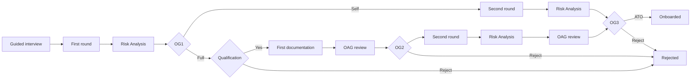

# PRD 0002: Staged evaluation

| | |
| --- | --- |
| **Status** | Accepted: the steering document for this work |
| **Date** | 2026-11-08 |
| **Owner** | aspapunktse |
| **Vocabulary** | [`CONTEXT.md`](../../CONTEXT.md) is the glossary of record. The new terms (Business System Owner, Requirement Round, Track, Onboarding Gate, Onboarding Advisory Group, Recommendation, Risk Analysis, Risk Source, Document Requirement, ATO, Change Review, IATO, cATO) are under "Evaluation" there. |
| **Decisions** | [ADR 0014](../adr/0014-staged-evaluation-oag-recommends-bso-decides.md) (staged evaluation; the advisory group recommends, the BSO decides), amending [ADR 0010](../adr/0010-onboarding-review-runs-as-parallel-review-steps.md). Also relies on [ADR 0001](../adr/0001-separate-approved-and-onboarded-states.md) and [ADR 0006](../adr/0006-continuous-compliance-replaces-draft-lock.md). |
| **Source** | The product owner's evaluation flowchart, grilled on 2026-11-08 (33 decisions). Issues #319 and #320 came out of that session. |

> As in PRD 0001, this document calls its own product requirements **features** (`F-<area>.<n>`), because "Requirement" is a domain term.

---

## 1. Summary

A new System is evaluated in stages instead of in one review. After the guided interview, the System answers a short **first Requirement Round** (vendor evaluation), and a **Risk Analysis** meeting follows. At **OG1** the stakeholder groups choose the **Self** track (self-assessment) or the **Full** track (a documented evaluation with advisory reviews). On both tracks a **Business System Owner (BSO)** makes the business decisions: to proceed (OG2) and to operate (OG3, the **ATO**). The stakeholder groups, the existing Review Groups and the base review, become the **Onboarding Advisory Group (OAG)**. They give Recommendations, and the BSO decides.

## 2. Problem

1. **One review for every System.** A low-risk SaaS tool and a critical platform go through the same submission and the same set of Review Steps. There's no light path, and no early check to decide which path a System needs.
2. **Compliance groups decide a business question.** A Review Step approves or rejects. Whether the enterprise should run a system despite gaps is a business decision, but the app has nobody accountable for it.
3. **Risk work isn't a step.** Risks are logged when a Self-Assessment Question is answered "No", but nothing makes the stakeholders gather the System's risks and give each an owner before the decision.
4. **Nothing beyond Controls.** An architecture description, a DPIA or an operations handover can't be required or tracked.
5. **No review after go-live.** A Framework added to an Onboarded System brings no review at all (the gap ADR 0010 accepted).

## 3. Goals and non-goals

**Goals**
- G1. Choose the evaluation depth per System early, from the first-round answers, judged by the groups that own each part.
- G2. Make one named business person decide whether a System proceeds and may operate, and make decisions against advice visible.
- G3. Make the Risk Analysis and the required documentation part of the flow.
- G4. Review a change after go-live with only the groups it affects.

**Non-goals (this PRD)**
- The **IATO** track for Systems already in evaluation when this ships (they stay on today's flow until then).
- **cATO**: answers re-given on a schedule, tied to Internal Audits and Check-ups.
- Risks not tied to Requirements (vendor, financial and the like). This PRD only adds the Risk Source they will use.
- An automatic or BSO-decided OG1.
- Following up the conditions in a "Recommend with conditions".
- ATO expiry or periodic re-authorization.
- Uploading files: documentation is linked, as evidence is today.
- Notifications beyond "My tasks".
- The Framework Owner curating their own Framework (#320).

## 4. Users and roles

| Who | New? | What they do here |
| --- | --- | --- |
| **Business System Owner (BSO)** | New per-System assignment (any User) | Decides Qualification, OG2, OG3 and Change Reviews for their Systems. Sees those Systems at every stage, with their gates in "My tasks". Can't be the System's owner and can't edit Assessments. |
| **Framework Owner** | New per-Framework assignment (any User), #319 | Marks which Controls mapped to their Framework are first round. |
| System's owner | Existing | Fills in both rounds and the documentation, and submits each stage. Picks the BSO in the interview. |
| OAG groups (Review Group members, Reviewers for the base review) | Existing, changed | Give the OG1 verdicts and the Recommendations on their remit. They no longer approve or reject. |
| Risk Owner | Existing, extended | Records the Risk Analysis meeting. Must not be the System's owner. |
| Compliance Manager | Existing, extended | Curates Document Requirements. Assigns Framework Owners (an Admin can too). |
| Admin | Existing | Can act for any of the above, except deciding on a System they own. |

## 5. The flow

Send back (from Qualification, OG2 or OG3) and the Change Review on an Onboarded System aren't drawn.

## 6. Features

Priority: **M** (must), **S** (should), **C** (could, later).

### F-FO: Framework Owner and first-round Controls (#319)

| ID | Pri | Feature |
| --- | --- | --- |
| F-FO.1 | M | Each Framework, the base included, has one Framework Owner, assigned by a Compliance Manager or an Admin. |
| F-FO.2 | M | The Framework Owner (or a Compliance Manager or an Admin) marks Controls mapped to the Framework as first round **for that Framework**. |
| F-FO.3 | M | A Control is first round on a System when any Framework in the System's effective scope has it marked. Every other applicable Control is second round. |

### F-BSO: Business System Owner

| ID | Pri | Feature |
| --- | --- | --- |
| F-BSO.1 | M | A System has a BSO, picked in the guided interview and required before the first round can go to OG1. The BSO can't be the System's owner. |
| F-BSO.2 | M | The System's owner or an Admin can change the BSO at any stage. Each change is a Change Event. |
| F-BSO.3 | M | The BSO sees their Systems at any stage, and gates waiting on them show in "My tasks". |

### F-ST: Tracks, stages and gates

| ID | Pri | Feature |
| --- | --- | --- |
| F-ST.1 | M | A System has a Track (not chosen, Self or Full) and a stage, following §5. Every move between stages is a Change Event. |
| F-ST.2 | M | The System's owner submits each round and documentation stage. Before OG1, every mandatory first-round Control needs an Assessment. Before the second round ends, every mandatory Control needs one. |
| F-ST.3 | M | **OG1**: every OAG group with first-round Controls in its remit, plus the base review (always), gives a Self or Full verdict with a comment. Any Full means Full. Verdicts follow the Review Step rules: derived live, reopened by an owner edit in the remit, shown as the group's. |
| F-ST.4 | M | **Qualification** (Full track): the BSO decides Yes, Reject or Send back, with a comment. |
| F-ST.5 | M | **OG2 and OG3**: the BSO decides Proceed (OG2) or Authorize to operate (OG3), Reject or Send back, with a comment. Deciding against an Advise-against needs a written justification, shown next to it. Before deciding, the BSO sees the Recommendations and a Risk summary (open Risks by severity and Risk Source). Open Risks never block. |
| F-ST.6 | M | **Reject** is final: the System is Rejected, closed and read-only. **Send back** goes to any earlier stage on the same Track, or to the first round, which re-runs OG1. |
| F-ST.7 | M | OG3 → ATO. The System's owner or an Admin then marks it Onboarded, as today (ADR 0001). |
| F-ST.8 | M | Nobody decides a gate or gives a verdict or Recommendation on a System they own. |

### F-OAG: Recommendations

| ID | Pri | Feature |
| --- | --- | --- |
| F-OAG.1 | M | At each OAG review on the Full track, every group with a remit on the System gives a Recommendation (Recommend, Recommend with conditions, or Advise against), always with a comment. Conditions are free text. |
| F-OAG.2 | M | Recommendations follow the Review Step rules of ADR 0010: derived live from scope, reopened by an owner edit in the remit, shown as the group's. The stage moves to the gate once every group has recommended. |
| F-OAG.3 | M | The Self track has no Recommendations. Assessment Queries stay available on both tracks. |

### F-RA: Risk Analysis and Risk Source

| ID | Pri | Feature |
| --- | --- | --- |
| F-RA.1 | M | A Risk has a **Risk Source**: requirement non-conformance, audit finding or ad hoc. Existing Risks get theirs from their current links. |
| F-RA.2 | M | A Risk Analysis records a date, participants (Users and named outsiders), notes, the Risks reviewed and new Risks raised in the meeting. A Risk Owner or an Admin who isn't the System's owner records it. |
| F-RA.3 | M | A Risk Analysis can be completed only when every open Risk on the System has a Risk owner. A Risk owner can be any User. |
| F-RA.4 | M | There are Risk Analyses at the first round and before OG3 on each track. |
| F-RA.5 | C | Other kinds of risk, as new Risk Sources. |

### F-DOC: Documentation

| ID | Pri | Feature |
| --- | --- | --- |
| F-DOC.1 | M | A Compliance Manager (or an Admin) curates **Document Requirements**. Each has a name, a description, the stage that needs it (first documentation or second round) and the Tracks it applies to. |
| F-DOC.2 | M | A System lists the Document Requirements that apply to it. Each is linked and marked provided by the System's owner. A stage can't be submitted until every applicable one is provided. |
| F-DOC.3 | S | Second-round Controls show whether evidence is attached, as part of documentation. |

### F-CR: Change Review

| ID | Pri | Feature |
| --- | --- | --- |
| F-CR.1 | M | A change to scope or classification that adds Controls to an OAG group's remit on an Onboarded System starts a Change Review. Only those groups give Recommendations. |
| F-CR.2 | M | The System stays Onboarded. The BSO accepts the change, or revokes the ATO and sends the System back to a stage they pick. |
| F-CR.3 | M | An Onboarded System without a BSO needs one before its Change Review can be decided. The Change Review shows in its owner's "My tasks" until a BSO is set. |

## 7. Migration of existing data

1. Systems in **Draft, In Review or Rejected** when this ships stay on today's flow (Draft → In Review → Approved → Onboarded) until the IATO track is built. Only Systems created after the switch use staged evaluation.
2. **Approved** Systems count as ATO. **Onboarded** Systems stay Onboarded.
3. No System has a BSO at first.
4. Every existing Risk gets its Risk Source from its links: an Assessment link means requirement non-conformance, a Check-up link means audit finding, anything else is ad hoc.
5. Existing Review Step decisions stay in the history as they are.

## 8. Milestones

Each milestone ships on its own. Design proposals for the evaluation view on the System page (with the shared appbar) come before milestone 3.

| # | Milestone | Features |
| --- | --- | --- |
| 1 | **Owners and sources** | F-FO.1–3 (#319), F-BSO.1–3, F-RA.1 |
| 2 | **Risk Analysis and documentation** | F-RA.2–4, F-DOC.1–3 |
| 3 | **Stages and OG1** | F-ST.1–3, F-ST.6–8 (Self track end to end, with OG3 decided by the BSO) |
| 4 | **Full track** | F-ST.4–5, F-OAG.1–3 |
| 5 | **Switch-over** | §7 migration; new Systems use staged evaluation |
| 6 | **Change Review** | F-CR.1–3 |

## 9. Success criteria

1. A new low-risk SaaS System goes from interview to ATO on the Self track with no OAG review.
2. A new critical System goes through the Full track, and its OG3 decision shows every group's Recommendation, plus the BSO's justification wherever the BSO went against advice.
3. Every ATO granted through staged evaluation has a completed Risk Analysis in which every open Risk has an owner.
4. Adding an export control Framework to an Onboarded System brings in only that Framework's group, and the BSO's decision is recorded.

## 10. Open questions

- **OQ-1: In-flight Systems before IATO.** They keep today's Review Steps, which approve or reject. *Default*: leave that code path in place until the IATO track replaces it, then remove it.
- **OQ-2: First round before any Controls are marked.** Until Framework Owners mark Controls, the first round is empty and only the base review gives an OG1 verdict. *Default*: allowed. The base review judges from the interview answers and the first Risk Analysis.
